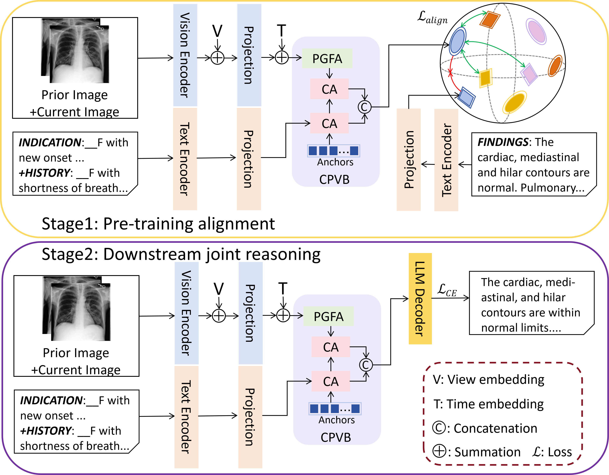

# CPVB-RG: Cross-Prior Visual Bridging for Prior-Aware Chest X-Ray Report Generation



[Paper (arXiv)](https://arxiv.org/abs/2610.28289) · Accepted at WACV 2027

This repository contains the core PyTorch implementation of **Progression-Guided Focus Attention (PGFA)** and the **Cross-Prior Visual Bridge (CPVB)**. PGFA contrasts progression-difference attention with shared-spatial attention. CPVB combines the resulting visual features with clinical text through two cross-attention units.

## Citation

```bibtex
@misc{xiang2026cpvbrgcrosspriorvisualbridging,
  title={CPVB-RG: Cross-Prior Visual Bridging for Prior-Aware Chest X-Ray Report Generation},
  author={Sike Xiang and Shuang Chen and Julie Cox and Amir Atapour-Abarghouei},
  year={2026},
  eprint={2610.28289},
  archivePrefix={arXiv},
  primaryClass={cs.CV},
  url={https://arxiv.org/abs/2610.28289}
}
```
